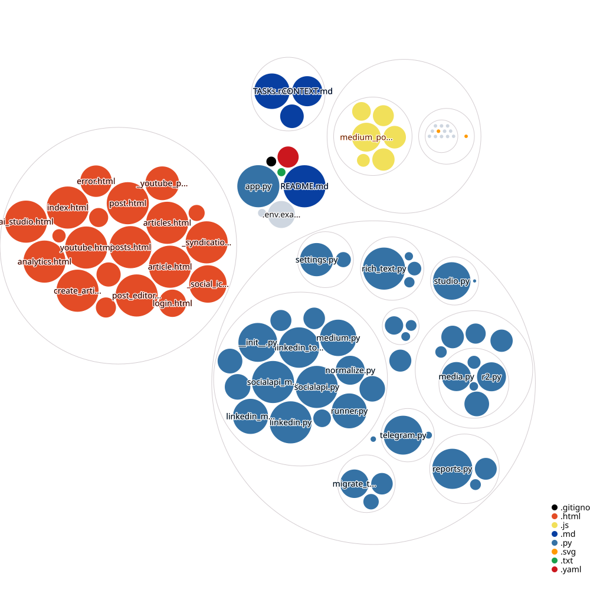

# Blog

A small, opinionated Flask blog with MongoDB storage (via MongoEngine), multi-platform POSSE syndication (Medium / LinkedIn / X / Bluesky / Instagram / Pinterest / Facebook / YouTube), first-party cross-channel analytics, and a Cloudflare tunnel for a public URL.

---

## Screenshots

### Public site

| Feed | Post |
| --- | --- |
|  |  |

| Article | Sign in |
| --- | --- |
|  |  |

### Admin

| Post Manager | Articles |
| --- | --- |
|  |  |

| New post | New article |
| --- | --- |
|  |  |

| Edit post | Edit article |
| --- | --- |
|  |  |

| Analytics |
| --- |
|  |

---

## Repo visualization



---

## Requirements

- Python 3.9+
- MongoDB — MongoEngine requires an active database instance (local `mongod` or MongoDB Atlas).
- Cloudflared (optional — only needed for exposing localhost via a Cloudflare Tunnel instead of using a cloud host).

---

## Step-by-Step Setup Guide

Follow these steps to replicate and run the blog from scratch:

### 1. Clone the Repository & Set Up Virtual Environment

```bash
git clone <repo_url>
cd Blog

# Create virtual environment
python -m venv .venv

# Activate virtual environment
# On Windows (Command Prompt / PowerShell):
.venv\Scripts\activate
# On Linux / macOS:
source .venv/bin/activate

# Install required dependencies
pip install -r requirements.txt
```

---

### 2. Configure Environment Variables (`.env`)

Create your `.env` file from the provided template:

```bash
cp .env.example .env
```

Here are specific configuration hints depending on your target environment:

#### A. Local Development Configuration (`.env`)

For testing on your local machine with local files and local MongoDB:

```env
# Core Flask Settings
SECRET_KEY=any-random-long-secret-key-string-for-sessions
PORT=5000
FLASK_DEBUG=1

# Admin Credentials (used at /login)
BLOG_ADMIN_USERNAME=admin
BLOG_ADMIN_PASSWORD=your-secure-password

# Public Site URL
SITE_URL=http://localhost:5000

# Storage Backends
DEFAULT_BACKEND=local
MEDIA_BACKEND=local
DB_BACKEND=local

# Local Database
LOCAL_MONGO_URI=mongodb://127.0.0.1:27017/blog_db

# Analytics
ANALYTICS_STORE=file
ANALYTICS_IP_SALT=local-salt-string
ANALYTICS_GEO=0
```

> [!TIP]
> Make sure your local MongoDB service is running before starting the app (`mongod`).

#### B. Cloud / Production Deployment Configuration (`.env`)

For hosted production (e.g., Render, Railway, VPS) with Cloudflare R2 and MongoDB Atlas:

```env
# Core Flask Settings
SECRET_KEY=generate-a-strong-random-hex-key-here
PORT=10000
FLASK_DEBUG=0

# Admin Credentials
BLOG_ADMIN_USERNAME=your_admin_username
BLOG_ADMIN_PASSWORD=your_strong_admin_password

# Public Site URL (canonical URLs and social platform webhooks)
SITE_URL=https://blog.yourdomain.com

# Storage Backends: set to 'cloud' for remote media & database
DEFAULT_BACKEND=cloud
MEDIA_BACKEND=cloud
DB_BACKEND=cloud
MEDIA_ADAPTER=r2

# Database: MongoDB Atlas
ATLAS_MONGO_URI=mongodb+srv://<db_user>:<db_password>@<cluster>.mongodb.net/?retryWrites=true&w=majority
# Or alternatively set:
# MONGO_URI=mongodb+srv://<db_user>:<db_password>@<cluster>.mongodb.net/blog_db

# Media Storage: Cloudflare R2 (S3-compatible, standard library, zero boto3)
R2_ACCOUNT_ID=your_cloudflare_account_id
R2_ACCESS_KEY_ID=your_r2_token_access_key
R2_SECRET_ACCESS_KEY=your_r2_token_secret_key
R2_BUCKET=your-bucket-name
R2_PUBLIC_BASE=https://pub-xxxxxx.r2.dev          # or custom domain like https://media.yourdomain.com

# Analytics
ANALYTICS_STORE=mongo
ANALYTICS_IP_SALT=your-production-secret-salt
ANALYTICS_GEO=1
```

---

### 3. Run the Application

```bash
python app.py
```

The database collections and indexes are initialized automatically on boot (`ensure_schema()` in `core/db/__init__.py`).
Open your browser and navigate to:
- Local: `http://localhost:5000`
- Production: `https://your-domain.com`

---

## Architecture & Layout

```text
app.py                       # Flask init + routes + app.run (thin controller layer)
core/
  __init__.py                # regular package marker
  config/    settings.py     # env variables + R2/Atlas infrastructure configurations
  providers/ base.py registry.py local.py cloud/{media,mongo,http,r2}.py # local vs cloud storage targets
  media/     uploads.py paths.py
  content/   rich_text.py helpers.py urls.py
  analytics/ events.py reports.py
  notify/    telegram.py
  syndication/ base.py socialapi.py socialapi_metrics.py linkedin.py linkedin_token.py linkedin_metrics.py imageprep.py rewrite.py textcard.py runner.py
  db/        models.py + __init__.py (connect_db, ensure_schema) + migrate_to_atlas.py
templates/  static/  media/  data/  .ai_docs/
```

- **Thin Controller:** `app.py` is restricted solely to application initialization and routing; core operational logic resides cleanly within decoupled `core/` modular packages.
- **Data Access:** Enforced strictly via MongoEngine Document mapping classes (`Post`/`Comment`/`AnalyticsEvent`) to guarantee structural schema arrays are preserved and never silently dropped.
- **Gotchas:** Feed views (`/posts`, `/articles`) are intentionally public feeds for visitors. Draft toggles, drafts count, and creation tools are strictly gated to authenticated sessions and verified devices.

---

## Storage & Cloud Migration Framework

The application implements a decoupled provider-agnostic storage abstraction layer allowing independent `local`/`cloud` target splits for database layers and asset storage blocks via configuration flags.

1. **Database Layer:** Supports local `mongod` configurations or remote MongoDB Atlas connection clusters. The LinkedIn OAuth token engine stores authentication metrics directly inside a persistent Mongo collection to guarantee deployment survival across ephemeral container instances.
2. **Media & Assets Backend:** Leverages a lightweight, standalone `stdlib`-only SigV4 Cloudflare R2 upload adapter (`core/providers/cloud/r2.py`) eliminating external cloud provider runtime SDK dependencies.
3. **Migration Tools:** A complete data utility script (`core/db/migrate_to_atlas.py`) manages the direct porting of legacy posts, comment metrics, token assets, and media components out of local file paths onto cloud infrastructure setups.

---

## Syndication & Content Optimization (POSSE)

The blog operates under strict **POSSE** rules (*Publish Own Site, Syndicate Elsewhere*). 

- **Automated Text Engine:** Multi-channel formatting evaluates text strings against destination boundaries (character thresholds, carriage returns, media links, and preview shorteners), triggering dynamic LLM contextual rewrites via Gemini API to fit platform profiles safely without harsh truncation.
- **LinkedIn Integration:** Dispatches content directly to **personal member profiles** using the official native API framework (bypassing commercial post credit requirements). Volatile tokens rotate seamlessly via automated long-lived background refresh flows.
- **YouTube Pipeline:** Dedicated tracking pages and inline panels capture video metrics and metadata bundles, converting files smoothly inside the SocialAPI adapter workflows.
- **Validation Engine:** Dry-run post validations (`POST /v1/posts/validate`) across Facebook, Instagram, YouTube, Bluesky, and Pinterest channels for credit-free integrity checks prior to publishing.

### Manual Setup for Optional Integrations

> [!NOTE]
> All core features (publishing posts & articles, comments, theme toggles, media uploads, and first-party analytics) work out of the box without LinkedIn or Medium. Configure these only if you want automatic syndication.

#### 1. Official LinkedIn Integration (OAuth 2.0 Self-Refreshing Token)
1. Create an app in the [LinkedIn Developer Portal](https://www.linkedin.com/developers/apps).
2. Add your credentials to `.env`:
   ```env
   LINKEDIN_CLIENT_ID=your_client_id
   LINKEDIN_CLIENT_SECRET=your_client_secret
   LINKEDIN_REDIRECT_URI=https://www.linkedin.com/developers/tools/oauth/redirect
   ```
3. Generate the authorization URL:
   ```bash
   python -m core.syndication.linkedin_token
   ```
4. Open the printed URL in your browser, approve access, and copy the `code` parameter from the redirect address bar.
5. Exchange the code and store the token:
   ```bash
   python -m core.syndication.linkedin_token <copied_code>
   ```

#### 2. Dev.to & Hashnode (Direct Official APIs)
* **Dev.to**:
  1. Go to **Dev.to -> Settings -> Extensions -> DEV Community API Keys**.
  2. Generate a key and add it to `.env`: `DEVTO_API_KEY=your_devto_api_key`
* **Hashnode**:
  1. Go to **Hashnode -> Account Settings -> Developer -> Personal Access Token**.
  2. Copy your token and Blog Publication ID, then add to `.env`:
     ```env
     HASHNODE_ACCESS_TOKEN=your_token
     HASHNODE_PUBLICATION_ID=your_publication_id
     ```

#### 3. Medium POSSE Integration (via Violentmonkey Userscript)
Medium has no public write API and blocks headless editor saves via Cloudflare protection. We bypass this cleanly using a Violentmonkey userscript:

1. **Install Violentmonkey**: Add the [Violentmonkey extension](https://violentmonkey.github.io/) to your browser (Chrome/Edge/Firefox).
2. **Install the Userscript**:
   - Open Violentmonkey dashboard -> **+ (New Script)**.
   - Paste the contents of [`static/js/medium_posse_userscript.user.js`](./static/js/medium_posse_userscript.user.js) and click **Save & Close**.
   - *(Or visit `https://your-domain/static/js/medium_posse_userscript.user.js` directly in your browser with Violentmonkey active to install in 1 click).*
3. **Syndicate to Medium**:
   - **Direct Importer**: On any published article or post page, click **"Publish to Medium"** / **"Medium Importer Fallback"**. This automatically copies the canonical URL to your clipboard and opens `https://medium.com/p/import` where the userscript auto-populates the input. Click **Import Story** to fetch your story with canonical SEO backlinks intact.
   - **Rich Story Bridge**: When logged in as Admin, clicking **"Syndicate to Medium"** opens `https://medium.com/new-story`, where the userscript automatically parses the article's rich HTML and dispatches a synthetic paste event directly into Medium's editor.

---

## Analytics & Editor Controls

- **Cross-Channel Monitoring:** The unified analytics dashboard (`/admin/analytics`) aligns first-party web metrics against granular per-post and per-platform social interactions.
- **Persistence:** Client actions are routed server-side via `navigator.sendBeacon` to protect tracking data events across rapid reader browsing.
- **Geo-Tracking:** Optional IP-hash analytics (`ANALYTICS_GEO=1`) verify country/state locations via salted beacons without capturing or persisting raw visitor IPs.
- **Rich Editor:** The writing interface features 14 customizable text blocks, live side-by-side platform rendering cards, and fluid drag-and-drop media attachment tools.

---

## Optional: Stealth Admin & Draft Isolation (Hiding Admin from Public Visitors)

> [!NOTE]
> This security feature is entirely **optional**. By default, standard web apps show the "Admin" or "Sign in" link in the navbar for anyone to click. This section describes how to configure the blog so that the Admin portal and draft items are **completely hidden and inaccessible to all public visitors**, appearing exclusively on your authorized hardware.

### How it works:
1. **Public Visitors / Other Devices:**
   - The **Admin** button does not appear in the navbar or on the homepage.
   - The **Published / Drafts toggle** on `/posts` and `/articles` is completely absent; only published content is rendered.
   - Navigating directly to `/login`, `/create_post`, `/create_article`, or `/admin/analytics` immediately aborts with **404 Not Found**.
   - Direct access to any draft URL (`/post/<draft_id>` or `/article/<draft_id>`) returns **404 Not Found**.

2. **Your Authorized Admin Device:**
   - **Localhost Development:** When developing locally via `localhost` or `127.0.0.1`, Admin controls and the Admin button are automatically visible.
   - **Hosted Production:** Upon logging in once with your admin credentials at `/login`, your browser receives a cryptographically signed HMAC-SHA256 device cookie (`admin_device_token`). The server validates this token using `SECRET_KEY` and `ADMIN_USERNAME`, permanently recognizing your specific browser as the verified Admin device.
   - Once recognized, the **Admin** button is displayed directly on the homepage, draft toggles appear on dashboard pages, and full management access is enabled.

### Optional Cloudflare Edge Enforcement (mTLS):
To block unauthorized traffic even before it reaches your origin server:
1. In the **Cloudflare Dashboard**, navigate to **SSL/TLS > Client Certificates** and generate a client certificate for your admin browser.
2. In **Security > Security Rules (Custom Rules)**, add a rule to block requests lacking a valid client certificate:
   ```text
   (not cf.tls_client_auth.cert_verified and http.request.uri.path in {"/login" "/create_post" "/create_article" "/admin/analytics"})
   ```
   Set action to **Block**.
3. In **Rules > Transform Rules (Modify Request Header)**, forward the verification status:
   - Match: `cf.tls_client_auth.cert_verified`
   - Set static header: `X-Client-Cert-Verified = SUCCESS`

---

## Production Operations, SEO & AI Context

- **Uptime & Cold Start Prevention (`/health`):** Isolated, zero-overhead health check endpoint returning `200 OK` (plaintext) designed for free external uptime monitors (such as cron-job.org) to prevent Render from idling.
- **Dynamic Error Pages & 404 Decoy:** Dynamic, dark-palette error page (`templates/error.html`) for 404, 403, and 500 errors. Unauthorized requests to protected admin endpoints are met with an unstyled, generic 404 decoy (`templates/admin_not_found.html`) with anti-indexing headers.
- **SEO & Anti-Indexing (`robots.txt` & `sitemap.xml`):** Fully compliant schema 0.9 XML sitemap dynamically indexing all published articles and posts. Automatic `X-Robots-Tag: noindex, nofollow, noarchive, nosnippet` injection for administrative paths and error responses.
- **AI Context Feed (`/llms.txt`):** Structured markdown catalog adhering to the llmstxt.org standard, enabling AI assistants and LLMs to ingest published work with clean markdown context instead of scraping rendered HTML.
- **Horizontal Management Menus:** Clean horizontal `...` buttons across all feeds and post detail views for quick editing and deletion (with CSRF and confirmation protection).
